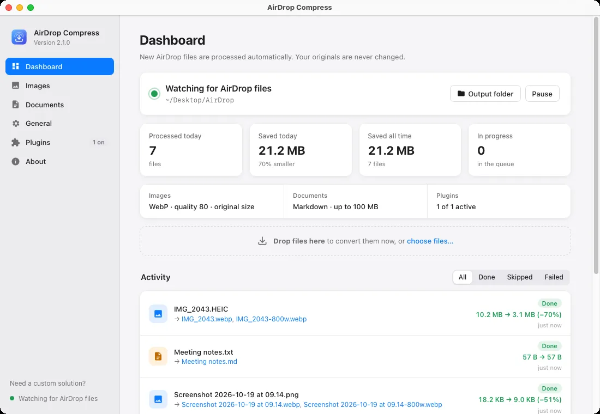

<p align="center">
  
</p>

<h1 align="center">AirDrop Compress</h1>

<p align="center">
  <b>Files you AirDrop to your Mac, made web-ready automatically.</b><br>
  Photos become compressed WebP, AVIF or JPEG. Documents become clean Markdown. Originals are never touched.
</p>

<p align="center">
  <a href="https://github.com/najathi/airdrop-compress/releases/latest/download/AirDrop-Compress-arm64.dmg"><b>Download for Mac</b></a> ·
  <a href="https://najathi.github.io/airdrop-compress/">Website</a> ·
  <a href="https://najathi.github.io/airdrop-compress/docs/">Documentation</a> ·
  <a href="CHANGELOG.md">What's new</a>
</p>

<p align="center">
  
</p>

## What it does

AirDrop Compress lives in your menu bar and watches the folder AirDrop saves to. When a file arrives, it:

- **converts images** (HEIC, JPEG, PNG, TIFF, GIF, BMP, WebP, AVIF) to **WebP**, **AVIF** or **JPEG**, or picks the smallest automatically, with options for quality, target file size, maximum dimensions, responsive `srcset` sizes, metadata, sRGB and SEO-friendly names;
- **converts documents** (PDF, Word, PowerPoint, Excel, RTF, ODT, HTML, CSV, EPUB, ZIP, text, code, contacts…) to **Markdown**;
- runs **plugins** you approve for anything else, in a macOS sandbox;
- saves results to an `airdrop-compress` folder, never touching your originals.

Everything runs on your Mac. Nothing is uploaded.

## Install

1. Download [**AirDrop-Compress-arm64.dmg**](https://github.com/najathi/airdrop-compress/releases/latest/download/AirDrop-Compress-arm64.dmg) (macOS 12 or later, Apple silicon).
2. Drag the app to **Applications** and open it.
3. The app isn't notarised yet: confirm once via **System Settings → Privacy & Security → Open Anyway**. The disk image includes an illustrated guide.
4. Allow access to your Desktop/Downloads folder when asked.

Details, Intel Macs and building from source: **[Install guide](docs/INSTALL.md)**.

## Documentation

| For users | For developers |
|---|---|
| [Install](docs/INSTALL.md) | [Contributing](CONTRIBUTING.md) |
| [User guide](docs/USER_GUIDE.md) | [Architecture](docs/ARCHITECTURE.md) |
| [Formats & compression options](docs/FORMATS.md) | [Plugin guide](docs/PLUGINS.md) |
| [Troubleshooting](docs/TROUBLESHOOTING.md) | [Building & releasing](docs/RELEASING.md) |
| [FAQ](docs/FAQ.md) | [Website deployment](docs/DEPLOYMENT.md) |
| [Changelog](CHANGELOG.md) | [Security policy](SECURITY.md) · [Audit](docs/SECURITY_AUDIT.md) |

## Quick start for developers

```bash
git clone https://github.com/najathi/airdrop-compress.git && cd airdrop-compress
python3 -m venv .venv && .venv/bin/pip install -r requirements-dev.txt
.venv/bin/python -m pytest                                   # tests
AIRDROP_COMPRESS_HOME=/tmp/adc-dev AIRDROP_DIR=/tmp/adc-inbox \
  .venv/bin/python -m airdrop_compress gui                   # run from source with a test profile
packaging/build.sh                                           # build the .app and .dmg
```

## Support

- Questions and bugs: [GitHub Issues](https://github.com/najathi/airdrop-compress/issues/new/choose)
- Security problems: report privately, see [SECURITY.md](SECURITY.md)
- **Need a custom solution, integration or business deployment?** [Email Najathi](mailto:najathi777@gmail.com?subject=Business%20inquiry%20-%20AirDrop%20Compress)

Built by **Najathi**: [GitHub](https://github.com/najathi) · [LinkedIn](https://www.linkedin.com/in/najathi/) · [Stack Overflow](https://stackoverflow.com/users/9181204/najathi)

## License

[MIT](LICENSE). Document conversion by [Microsoft MarkItDown](https://github.com/microsoft/markitdown). Image codecs: libwebp, libavif, libjpeg-turbo, libheif (via Pillow and pillow-heif).
